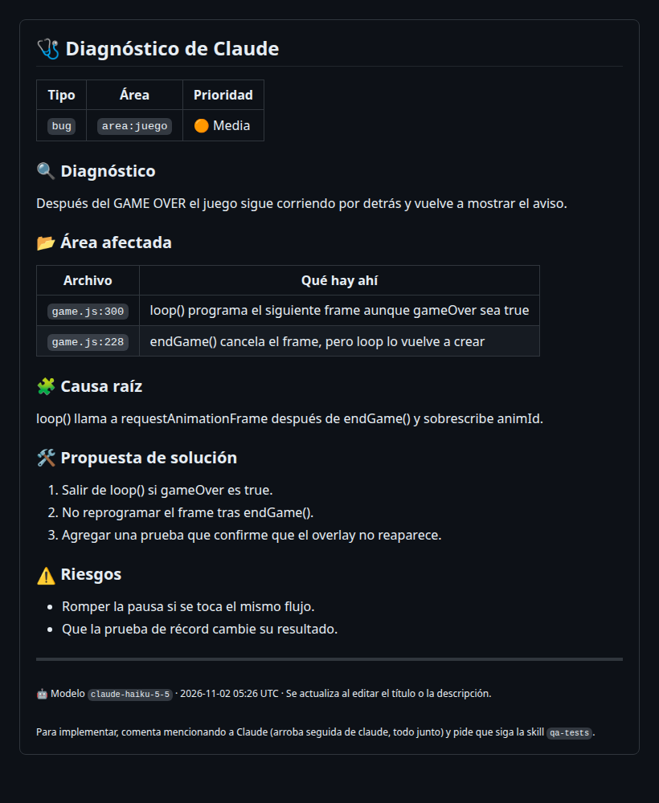
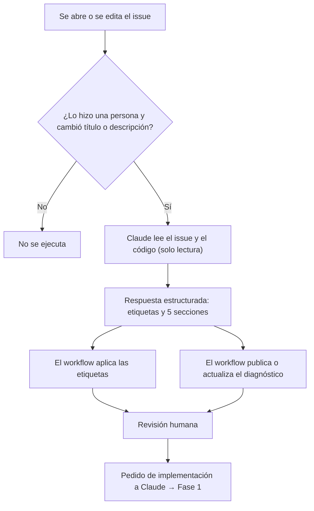

# Fase 0 · Diagnóstico y etiquetas

**Qué pasa:** al abrir un issue, o al editar su título o descripción, Claude lo analiza solo. Asigna etiquetas y publica un comentario de diagnóstico. No implementa nada.

**Workflow:** `.github/workflows/claude-issue-triage.yml`.

**Etiquetas posibles:**

| Grupo | Etiquetas |
|---|---|
| Tipo | `bug`, `enhancement`, `documentation`, `question` |
| Área | `area:juego`, `area:qa`, `area:docs`, `area:workflows` |
| Prioridad | `prioridad:alta`, `prioridad:media`, `prioridad:baja` |

El workflow crea las de área y prioridad si no existen. Solo agrega etiquetas: nunca quita las que puso una persona.

**El comentario tiene siempre cinco secciones:**
1. Diagnóstico
2. Área afectada (archivos y funciones)
3. Causa raíz
4. Propuesta de solución
5. Riesgos

Claude responde con piezas cortas: una o dos frases para el diagnóstico y la causa, y listas breves para el resto. El workflow arma el Markdown con un formato fijo (tabla de etiquetas, tabla de archivos, pasos numerados y viñetas) y recorta lo que se extienda: máximo 4 archivos, 5 pasos y 3 riesgos.

Hay un solo comentario por issue: si se edita el issue, se actualiza en lugar de crear otro.

**Seguridad:** Claude solo puede leer archivos. Las etiquetas salen de una lista cerrada, y el workflow es quien las aplica. Por defecto, la acción solo atiende issues de personas con permiso de escritura en el repo.

**Siguiente paso:** revisar el diagnóstico y pedir la implementación → [Fase 1 · Implementación](fase-1-implementacion.md).
